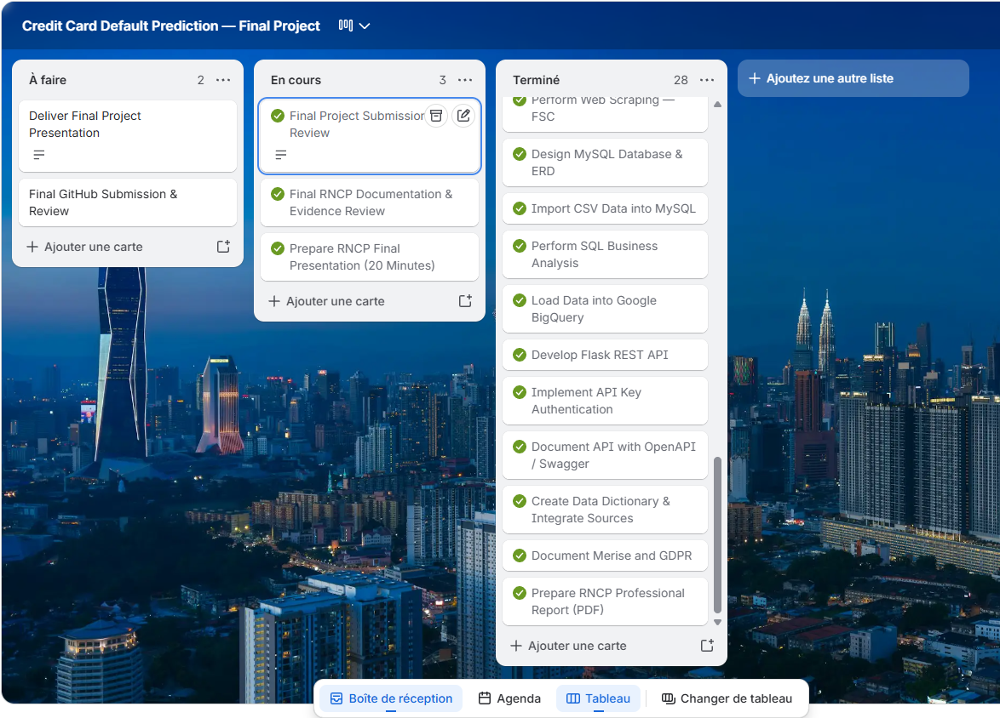
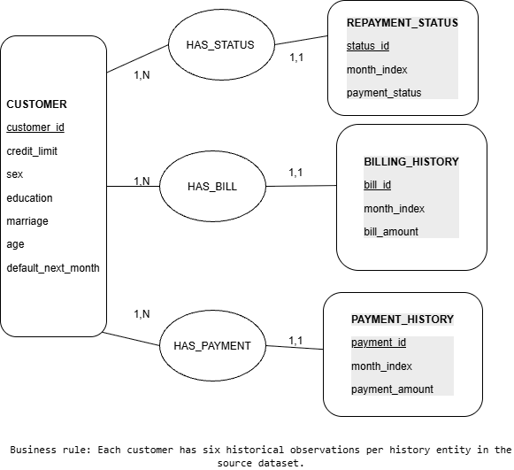

# Credit Card Default Prediction — RNCP Bloc 1

**GitHub Repository:** https://github.com/elshir-da/credit_card_default_rncp_bloc1

## Project Overview

**Project type:** RNCP Bloc 1 — Data Engineering & Analytics (educational proof of concept)  
**Core tools:** Python, Jupyter, MySQL, SQL, Google BigQuery, Flask, OpenAPI/Swagger, Tableau, XGBoost and SHAP  
**Presentation:** Eight Tableau Story pages, including an introduction and final conclusions. The packaged workbook `Credit_Card_Default_RNCP_Tableau.twbx` is shared through the GitHub repository for assessment; it is **not** published on the Tableau Public website.


This project combines an end-to-end machine learning workflow with a small data engineering implementation. The machine learning component predicts whether a credit card customer will default on the following monthly payment using the **Default of Credit Card Clients** dataset; exploratory simulations examine potential credit-risk management decisions. The data engineering component demonstrates data ingestion, relational database design, cloud SQL, and basic data access through an API.

The goal is to support earlier identification of customers at risk of default while recognizing the trade-off between missed defaults and unnecessary reviews.

> **Project status:** The machine learning analysis, exploratory business simulations, and educational data engineering prototypes are complete. Data engineering work includes MySQL, SQL analysis, BigQuery, a local Flask API, an external API request, and web scraping. These are separate proof-of-concept components, **not** a production deployment or an automated end-to-end pipeline.

## Project Planning

Project tasks were managed using Trello, with three workflow stages: To Do, In Progress, and Done.

The board tracks data collection, data cleaning, MySQL database design, BigQuery analysis, Flask API development, GDPR documentation, and final project deliverables.



## Business Problem

Credit card default is a challenge for financial institutions. A model that misses too many defaulting customers may fail to identify important risks, while a model that flags too many non-defaulting customers may generate unnecessary review costs.

This project asks:

- Can customer repayment, billing, and demographic data help predict next-month default?
- How should precision and recall be balanced for risk identification?
- How could model scores support hypothetical review prioritization and risk segmentation?

## Dataset

**Source:** UCI Machine Learning Repository — *Default of Credit Card Clients*  
**Dataset link:** https://archive.ics.uci.edu/dataset/350/default+of+credit+card+clients

- **Observations:** 30,000 customers
- **Original columns:** 25, including customer ID and target
- **Target:** `default_next_month` (1 = default; 0 = no default)
- **Class distribution:** 6,636 defaults (22.12%) and 23,364 non-defaults (77.88%)

Variables cover credit limits, demographic characteristics, repayment status, bill amounts, and previous payment amounts. The underlying customer observations concern Taiwan in **2005**; findings should not be assumed to generalize to today's banking populations. The machine learning notebook uses the standardized target name `default_next_month`. The cleaned CSV uses `default payment next month` (Tableau may display `Default Payment Next Month`); BigQuery column names may reflect the imported source header. The cleaned customer CSV (`credit_card_default_clean.csv`) is included as a reproducibility artifact derived from the public UCI dataset; see the dataset attribution and licensing section below.

## Machine Learning Workflow (Step 0–8)

1. **Data loading and inspection:** Review the dataset structure, target balance, and variable definitions.
2. **Data cleaning:** Prepare a consistent dataset for analysis.
3. **Exploratory data analysis (EDA):** Examine distributions and relationships with default.
4. **Feature engineering and preprocessing:** Create behavioral features and apply appropriate preprocessing inside scikit-learn pipelines.
5. **Model development:** Establish SGD, Random Forest, and XGBoost baselines; tune XGBoost using cross-validation.
6. **Final evaluation:** Evaluate classification metrics, confusion matrix, feature importance, and SHAP explanations.
7. **Business simulations:** Explore hypothetical error costs, risk review capacity, risk segments, and intervention sensitivity.
8. **Conclusion and future work:** Discuss practical implications, limitations, and next steps.

### Feature Engineering

Six additional features were developed:

- `avg_bill_amount`
- `avg_payment_amount`
- `payment_to_bill_ratio`
- `credit_utilization`
- `max_payment_delay`
- `months_with_delay`

An `age_group` variable was used for exploratory analysis only and excluded from model training.

### Modeling Approach

- **Train/test split:** Stratified 80/20 split (`random_state=1`)
- **Preprocessing:** Imputation, scaling, and categorical encoding in a pipeline
- **Models considered:** SGD classifier, Random Forest, and XGBoost
- **Primary tuning metric:** Cross-validation F1-score
- **Selected model:** Weighted XGBoost with `scale_pos_weight = 2.5`

F1-score was selected to balance detecting actual defaults (recall) against limiting false alarms (precision). Alternative class weights were explored for comparison: `1.0` favored cross-validation accuracy/precision, while `4.0` favored recall. The final weight of `2.5` achieved the highest cross-validation F1-score among the tested values.

## Results

### Selected Weighted XGBoost — Test Set

The figures below come from a held-out test set of 6,000 customers (20% of the UCI observations).

| Metric | Result |
|---|---:|
| Accuracy | 0.7897 |
| Precision | 0.5224 |
| Recall | 0.5712 |
| F1-score | 0.5457 |
| ROC-AUC | 0.7818 |

**Confusion matrix (6,000 test customers):**

| Actual / Predicted | No Default | Default |
|---|---:|---:|
| No Default | 3,980 (TN) | 693 (FP) |
| Default | 569 (FN) | 758 (TP) |

For context, the random-search XGBoost test metrics were **82.05% accuracy, 66.89% precision, 37.30% recall, 47.90% F1-score, and 0.7820 ROC-AUC**. Compared with that configuration, the selected weighted model detected **263 additional actual defaults**, while generating **448 additional false positives** on the same test set.

These results illustrate a trade-off rather than an unqualified improvement across all metrics.

### Model Interpretability

Global SHAP analysis highlights repayment delays, recent repayment status, and credit utilization among important model signals. The local waterfall plot illustrates one individual prediction. SHAP contributions explain model output (in the presented setting, on a log-odds scale), **not directly calibrated default probabilities**. These analyses describe model behavior and associations; they do not establish causal relationships.

Illustrative figures available in the project materials include `SHAP Summary Plot.png` and `SHAP Water fall.png`.

## Exploratory Business Simulations

All figures in this section are **illustrative scenario calculations**, not observed bank costs, actual interventions, or realized savings.

### Prediction Error Cost Scenario

Using hypothetical costs of **€1,000 per false negative** and **€50 per false positive**:

| Model | Illustrative Error Cost |
|---|---:|
| Random-search XGBoost | €844,250 |
| Weighted XGBoost (`scale_pos_weight = 2.5`) | €603,650 |

These assumptions demonstrate how the relative costs of missed defaults and false alarms can change the preferred model. This **classification-error scenario** is separate from the **intervention strategy scenario** below; their input assumptions and totals should not be mixed.

### Risk Review Capacity

Ranking test customers by predicted risk score, the top **500** contained **361 actual defaults**, corresponding to **72.2% precision** and **27.20% recall** for that review capacity. This is a retrospective ranking analysis, not evidence that defaults would be prevented.

### Risk Segmentation

An illustrative segmentation of the 6,000 test customers used model-score thresholds:

| Segment | Score Range | Customers | Observed Default Rate |
|---|---|---:|---:|
| Low | < 0.30 | 3,063 | 9.37% |
| Medium | 0.30–<0.60 | 1,902 | 21.77% |
| High | ≥ 0.60 | 1,035 | 60.48% |

These thresholds are exploratory, and the class-weighted model scores have **not** been established as calibrated default probabilities.

### Hypothetical Intervention Strategies

Illustrative assumptions: **€1,000 per actual default**, **€40 per manually reviewed customer**, **€2 per reminder**, **20% manual-review effectiveness**, and **5% reminder effectiveness**. No real-world intervention effect has been established.


| Strategy | Modeled Cost |
|---|---:|
| A — No interventions | €1,327,000 |
| B — Manual review above score 0.50 | €1,233,440 |
| C — High-risk manual review plus medium-risk reminders | €1,226,304 |

Under the stated assumptions, Strategy C is **€100,696 lower in modeled cost than Strategy A**. Sensitivity analysis favored Strategy C in three of four tested scenarios; when reminders had no effect, Strategy B performed better.

These differences **must not** be presented as verified financial savings or prevented defaults.

## Data Engineering Implementation (RNCP Workstream)

This workstream reuses the credit card topic while demonstrating basic data collection, storage, querying, and delivery. It is **separate from the trained model**: the external statistics have not been merged into the UCI customer-level dataset or used to retrain XGBoost.

### Data Sources and Collection

| Source | Method | Output | Scope |
|---|---|---|---|
| UCI *Default of Credit Card Clients* | Local CSV | `credit_card_default_clean.csv` | 30,000 historical customer records (2005) |
| Taiwan National Credit Card Center (NCCC) | HTTP request to an official open-data endpoint | `credit_card_api.csv` | 17 annual records, 2009–2025 |
| Taiwan Financial Supervisory Commission (FSC) | `requests` + `BeautifulSoup` from a public web page | `credit_card_scraping.csv` | 2 published financial indicators at the time of collection |

The NCCC response is **CSV-formatted text**, even though it was retrieved through an HTTP API endpoint. The extracted measures describe annual cash-advance amount (**100 million TWD**) and number of transactions (**thousand transactions**). The FSC indicators include cards in circulation (**thousand cards**) and aggregate credit card debt (**NT$ billion**). Units are preserved and should not be mixed.

- [NCCC official API endpoint](https://bas.nccc.com.tw/nccc-nop/OpenAPI/A08/ATMCashAdvanceTransaction)
- [FSC Financial Competitiveness Key Information](https://stat.fsc.gov.tw/competitivenessinfoen)

The external sources provide **market-level context** from a different period and at a different level of aggregation. They cannot be joined to UCI customers by `ID`, and their measures must not be presented as directly comparable to the UCI next-month default label. Values on the FSC webpage can change over time.

### Data Integration and Dictionary

The collection demonstrations were documented and standardized in `data_integration.ipynb`. The `data_dictionary.csv` describes **33 fields**; `integrated_industry_data.csv` contains **36 industry-indicator records** (**34 API-derived records and 2 FSC indicators**). These are market-level context records and are **not appended to the 30,000 UCI customer rows**.

### MySQL Relational Database

A local MySQL database named `credit_card_default_db` was created from the cleaned credit card CSV, with **four tables and three one-to-many foreign-key relationships**:

| Table | Description | Imported Rows |
|---|---|---:|
| `customers` | Customer attributes, credit limit, and default outcome | 30,000 |
| `repayment_status` | Six repayment-status observations per customer | 180,000 |
| `billing_history` | Six bill amounts per customer | 180,000 |
| `payment_history` | Six prior payment amounts per customer | 180,000 |
| **Total** | | **570,000** |

Each history table references `customers.customer_id`. Its `month_index` (1–6) is an **ordered position in the source's six-month history**, not a calendar month. The schema is documented in the EER/ERD diagram.

Five SQL business queries demonstrate aggregation and joins: overall default rate, default rate by education, average credit limit by outcome, repayment status versus default rate, and average bill versus payment amount.

**Local artifacts:** `create_database.sql`, `import_to_mysql.ipynb`, `business_analysis.sql`, `ERD1.png`, `ERD2.png`, and `merise_documentation.md`.

### Merise Conceptual Data Model (MCD)

A formal Merise conceptual data model was developed to complement the physical MySQL ERD.

The MCD contains four entities (Customer, Repayment Status, Billing History, and Payment History), three named associations, and their cardinalities.

Each customer is associated with multiple historical records (1,N), while each historical record belongs to exactly one customer (1,1).

- 
- [Download the editable MCD](Merise_MCD_Credit_Card_Default.drawio)

The conceptual model and the physical database implementation are documented separately in `merise_documentation.md` and the MySQL ERD diagrams.

### Google BigQuery

A separate BigQuery Sandbox prototype was created:

- **Google Cloud project:** `credit-card-default-project`
- **Dataset:** `credit_card_default`
- **Table:** `customers` (30,000 rows from the cleaned CSV)
- **Analysis:** Three queries covering overall default rate, average credit limit by default status, and repayment status versus default rate.

Query source is saved in `bigquery_analysis.sql`. The BigQuery dataset is a **cloud copy of the wide customer CSV**, not a replication of the four-table MySQL schema.

### Local Flask API

A local Flask application (`app.py`) connects to the MySQL prototype and demonstrates **four read-only GET endpoints** across customer and default resources. The API is documented in `openapi.yaml` and illustrated by `swagger_api_documentation.png`.

| Method | Endpoint | Purpose |
|---|---|---|
| `GET` | `/customers/count` | Total customer count |
| `GET` | `/defaults/summary` | Customer count, default count and default rate |
| `GET` | `/customers?page=1&limit=10` | Paginated customer records (example query parameters) |
| `GET` | `/customers/{customer_id}` | Retrieve a customer by ID |

The endpoints were tested in a **local development environment** (`http://127.0.0.1:5000`). The prototype uses **API-key authentication configured from the environment**; it is not a publicly deployed or production-grade service. Use your own local MySQL configuration and credentials, and refer to `app.py` and `openapi.yaml` for the actual required environment variables and request authentication header. **Do not commit secrets or `.env` files.**

### Security, Privacy and Documentation

The RNCP evidence includes a data dictionary, `merise_documentation.md`, `gdpr_documentation.md`, and `gdpr_deletion_demo.sql`. The deletion demonstration is a **rollback exercise** rather than evidence of a permanent production deletion. The API-key check, Swagger documentation, and local-only deployment are useful prototype safeguards but are **not** a complete GDPR or production security compliance assessment.

### Data Engineering Deliverables

- **Collection and integration:** `external_api.ipynb`, `credit_card_api.csv`, `web_scraping.ipynb`, `credit_card_scraping.csv`, `data_integration.ipynb`, `data_dictionary.csv`, `integrated_industry_data.csv`
- **MySQL and business analysis:** `create_database.sql`, `import_to_mysql.ipynb`, `business_analysis.sql`, `ERD1.png`, `ERD2.png`
- **BigQuery:** `bigquery_analysis.sql`, `bigquery_results.png`
- **Flask and API documentation:** `app.py`, `openapi.yaml`, `swagger_api_documentation.png`, `flask_customer_count.png`, `flask_default_summary.png`
- **Governance:** `gdpr_documentation.md`, `merise_documentation.md`, `gdpr_deletion_demo.sql`, `gdpr_deletion_evidence.png`
- **Machine learning and explainability:** `credit_card_default_project.ipynb`, `SHAP Summary Plot.png`, `SHAP Water fall.png`, `Estimated Business Error Cost by Model.png`
- **Interactive presentation:** `Credit_Card_Default_RNCP_Tableau.twbx` (eight Tableau Story pages)
- **Customer data:** `credit_card_default_clean.csv` (UCI-derived cleaned data, with attribution below)

These artifacts are independent demonstrations of the required techniques. In particular, the project does not claim that MySQL, BigQuery, the external sources, Flask, and the ML model are connected by an automated pipeline.

## RNCP Tableau Presentation

An **eight-page Tableau Story** was prepared for the oral defense:

1. Project Introduction
2. Credit Card Default: Business Context & EDA
3. External Data Sources: NCCC API & FSC Web Scraping
4. Data Engineering Architecture (MySQL, BigQuery, Flask/OpenAPI)
5. Machine Learning Results & Hypothetical Business Impact
6. Model Explainability: Global and Local SHAP
7. Model Development & Comparison
8. Conclusion, Business Recommendation, Limitations & Q&A

The Tableau dashboard uses the UCI-derived customer data, NCCC and FSC contextual indicators, and selected notebook-generated images. **The packaged workbook [`Credit_Card_Default_RNCP_Tableau.twbx`](Credit_Card_Default_RNCP_Tableau.twbx) is included in this repository for RNCP assessment.** Reviewers can download it and open it with a compatible version of Tableau. A packaged workbook may contain embedded data extracts and images; it does not need to be published to the Tableau Public website. Check the included content and any applicable data-source terms before sharing the repository beyond its intended reviewers.

## Running the Project

### Requirements

- Python 3.x with Jupyter Notebook / JupyterLab or VS Code
- Machine learning: `pandas`, `numpy`, `matplotlib`, `seaborn`, `scikit-learn`, `xgboost`, and `shap`
- Data engineering: `requests`, `beautifulsoup4`, `sqlalchemy`, `pymysql`, and `flask`
- Local **MySQL Server** and **MySQL Workbench** for database setup and queries
- A Google Cloud project with access to **BigQuery Sandbox** for the cloud SQL demonstration

Install the required packages in your own environment, for example:

```bash
pip install jupyter pandas numpy matplotlib seaborn scikit-learn xgboost shap requests beautifulsoup4 sqlalchemy pymysql flask
```

### Run the Machine Learning Notebook

The main notebook is [`credit_card_default_project.ipynb`](credit_card_default_project.ipynb).

1. Clone or download this GitHub repository.
2. Install the required Python packages using the command above.
3. Use the included `credit_card_default_clean.csv` for the notebook and MySQL/BigQuery demonstrations. Check the input path in each notebook and adjust it if necessary. The source UCI data can also be downloaded using the link above.
4. Open the Notebook using Jupyter Notebook, JupyterLab, or VS Code.
5. Select **Restart Kernel and Run All Cells** to execute the complete analysis.

**Note:** Reproducing the notebook requires the expected cleaned data columns and matching local file paths. Confirm notebook paths before using Run All. The notebook may include environment-specific paths or outputs and is provided as an educational project rather than a guaranteed one-command pipeline.

### Reproduce the Data Engineering Demonstrations

1. **MySQL:** Run `create_database.sql` in MySQL Workbench. Then open `import_to_mysql.ipynb`, read `credit_card_default_clean.csv`, connect with your own local MySQL credentials, and import the four tables. Run `business_analysis.sql` to verify the data and calculate indicators. The import script is intended for initially empty tables and prevents a repeated import into nonempty tables.
2. **BigQuery:** Create a Google Cloud project and dataset, upload `credit_card_default_clean.csv` as a BigQuery table, and run the three statements from `bigquery_analysis.sql`. Project and table references in the SQL must match your own Cloud environment.
3. **Flask:** Start the local MySQL server; configure the database connection and API key as specified in `app.py`; then run `python app.py`. Call the documented endpoints using the API key/header described in `openapi.yaml` (for example, through Swagger or an API client). Do **not** assume that simply visiting a protected endpoint without a key will work.
4. **External API:** Execute `external_api.ipynb` to request the NCCC endpoint, parse its CSV-style response, standardize English field names, and export `credit_card_api.csv`.
5. **Web scraping:** Execute `web_scraping.ipynb` to retrieve and parse the public FSC web page, extract the two documented indicators, and export `credit_card_scraping.csv`. Check the site's current access conditions before new automated requests.

**Security:** Do not upload passwords, tokens, private credentials, or `.env` files to GitHub. The Flask app is intended to run locally, not as a production banking service.

### Repository File Inventory

The following are the principal deliverables described in this README. File names should match the uploaded GitHub repository; this document is not a live verification of repository contents.

```text
README.md                                  # GitHub project documentation
credit_card_default_project.ipynb          # Main ML workflow (Steps 0–8)
credit_card_default_clean.csv              # Cleaned UCI customer dataset
Credit_Card_Default_RNCP_Tableau.twbx      # Eight-page interactive Tableau Story

external_api.ipynb                         # NCCC data collection
web_scraping.ipynb                         # FSC public-page extraction
data_integration.ipynb                     # External-indicator integration
credit_card_api.csv                        # NCCC annual extract
credit_card_scraping.csv                   # FSC indicator extract
integrated_industry_data.csv               # 36 market-indicator records
data_dictionary.csv                        # Metadata for 33 fields

create_database.sql                        # MySQL schema
import_to_mysql.ipynb                      # Load customer and history tables
business_analysis.sql                      # Five business SQL queries
ERD1.png
ERD2.png

bigquery_analysis.sql                      # Three cloud SQL queries
bigquery_results.png

app.py                                     # Local read-only Flask API
openapi.yaml                               # API specification
swagger_api_documentation.png
flask_customer_count.png
flask_default_summary.png

gdpr_documentation.md
merise_documentation.md
gdpr_deletion_demo.sql
gdpr_deletion_evidence.png

SHAP Summary Plot.png
SHAP Water fall.png
Estimated Business Error Cost by Model.png

Merise_MCD_Credit_Card_Default.png       # Formal Merise MCD
Merise_MCD_Credit_Card_Default.drawio    # Editable conceptual model
Credit_Card_Default_RNCP_Bloc1_Report_11_Pages.pdf  # RNCP professional report
```

### RNCP Submission Deliverables

The principal assessment deliverables include:

- **Professional report:** The 14-page RNCP Bloc 1 report in PDF format.
- **Presentation:** `Credit_Card_Default_RNCP_Tableau.twbx`, containing eight Tableau Story pages.
- **Project code and data:** Python notebooks, CSV datasets, SQL scripts, and Flask API implementation.
- **Database modeling:** Formal Merise MCD, editable `.drawio` source, and MySQL ERD diagrams.
- **Technical documentation:** README, data dictionary, OpenAPI specification, and GDPR documentation.
- **Project planning:** Trello board used to manage the project.

Additional evidence screenshots and a `requirements.txt` dependency file may be included as supplementary materials.

### Data Attribution, Licensing and Sharing

- **UCI source:** Yeh, I. (2009). *Default of Credit Card Clients* [Dataset]. UCI Machine Learning Repository. https://doi.org/10.24432/C55S3H
- **UCI dataset license:** [Creative Commons Attribution 4.0 International (CC BY 4.0)](https://creativecommons.org/licenses/by/4.0/). The repository's `credit_card_default_clean.csv` is a cleaned and column-standardized derivative of the source data for educational use; the dataset author and license are acknowledged here. The customer observations date to 2005, while 2009 is the dataset citation/publication year.
- **External context sources:** NCCC API and FSC financial indicators (links above). These are separate public sources; UCI's CC BY 4.0 license does **not** automatically apply to the NCCC/FSC data. Respect each source's applicable reuse and attribution conditions.
- **Tableau:** `Credit_Card_Default_RNCP_Tableau.twbx` is made available through this repository for RNCP assessors. It is not published on the Tableau Public website. A `.twbx` may embed source extracts and images, so review its contents and permissions before public redistribution.
- **Repository security:** Never commit `.env` files, passwords, personal API keys, database credentials, service-account files, or secrets in notebook outputs. If credentials were ever committed, rotate them and address Git history; a later file deletion alone is insufficient.

## Limitations

- The dataset is historical and may not represent current customers or economic conditions.
- Default is an imbalanced outcome, making accuracy insufficient as a stand-alone selection metric.
- Repeated exploratory comparisons on the same test set limit the independence of the reported evaluation.
- Class-weighted risk scores are not necessarily calibrated probabilities.
- Business simulations rely on assumed losses, operational costs, and intervention effectiveness.
- Fairness, independent external validation, operational monitoring, and human oversight require further work before deployment.
- External market statistics cover different periods and aggregation levels and are not joined to individual UCI customer records.
- The current MySQL, BigQuery, Flask, API, and scraping components are separate educational prototypes rather than a secure, monitored production pipeline.

## Future Work

- Validate on newer, representative, independent datasets.
- Evaluate probability calibration, subgroup fairness, and model drift.
- Validate business assumptions with real operational evidence.
- If needed, integrate the completed data engineering prototypes into a reproducible automated pipeline, including data-source validation and monitoring.
- Establish appropriate human review and governance for consequential decisions.

## Project Scope and Disclaimer

This project is an **educational proof of concept**, not a deployable credit decision system. The Flask API is a local read-only demonstration, not a production banking application. Predictions, rankings, and hypothetical financial scenarios must not be used as the sole basis for real-world credit decisions.

## Acknowledgment

Dataset: *Default of Credit Card Clients*, UCI Machine Learning Repository. Original study by Yeh and Lien (2009). The 2009 citation is the publication date; the customer records are from 2005.
